<p align="center">
  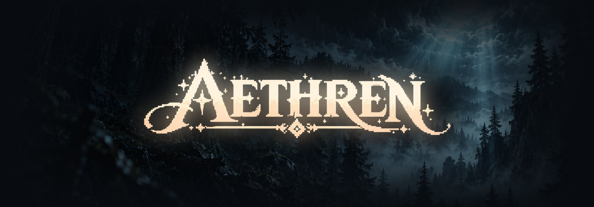
</p>

<p align="center">
  <b>A pixel-art fantasy adventure you play with a homemade enchanted glove.</b><br>
  Turn the dial to pick a spell, weave it with button taps, swings and your own body,<br>
  fight a wolf pack and a ruined knight alone or with a friend, or face a rival Spellbearer in a high-speed duel.
</p>

<p align="center">
  
  
  
  
  
  
</p>

---

## Contents

- [The game](#the-game)
- [The enchanted glove](#the-enchanted-glove)
- [Casting a spell](#casting-a-spell)
- [Combat](#combat)
- [Co-op on two screens](#co-op-on-two-screens)
- [Duel mode (PvP & AI Speed Contest)](#duel-mode-pvp--ai-speed-contest)
- [How it fits together](#how-it-fits-together)
- [Getting started](#getting-started)
- [Repository layout](#repository-layout)
- [Debug labs](#debug-labs)

---

## The game

A rift of light splits a rainy forest at night, and a child steps out of it. Two hooded figures watch from the trees. One whispers *run, little shadow*, and the other says *stay*. Whatever you choose, something in the bushes has already found you.

<table>
  <tr>
    <td width="50%">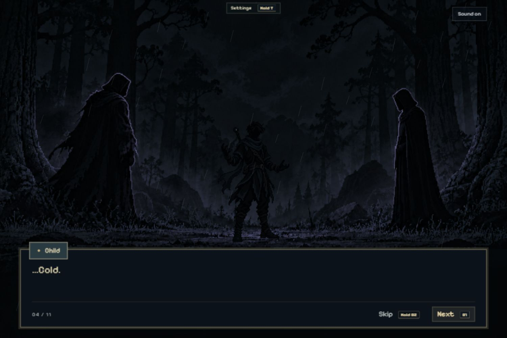</td>
    <td width="50%">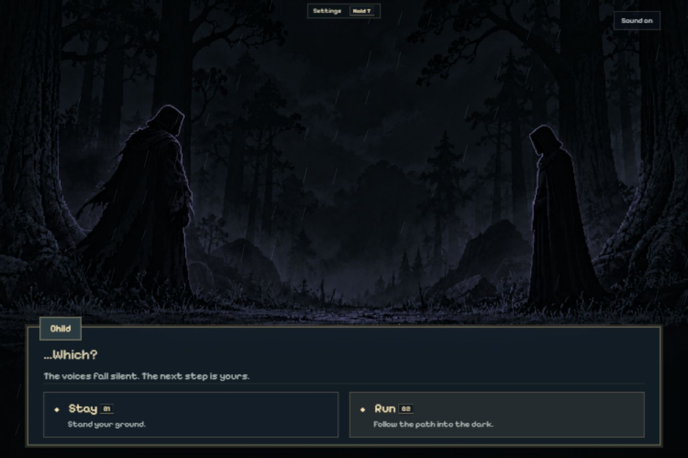</td>
  </tr>
  <tr>
    <td align="center"><sub><b>The Rift.</b> Authored visual-novel scenes with voices, rain and lightning.</sub></td>
    <td align="center"><sub><b>…Which?</b> Stay (B1) or Run (B2). Each path has its own lead-in.</sub></td>
  </tr>
  <tr>
    <td width="50%">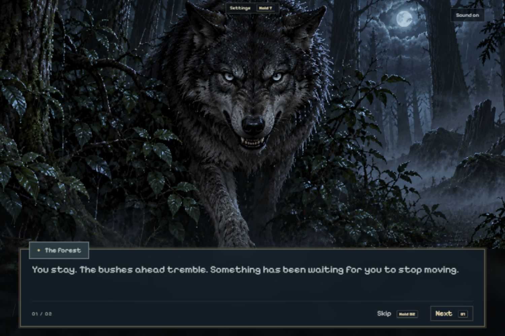</td>
    <td width="50%">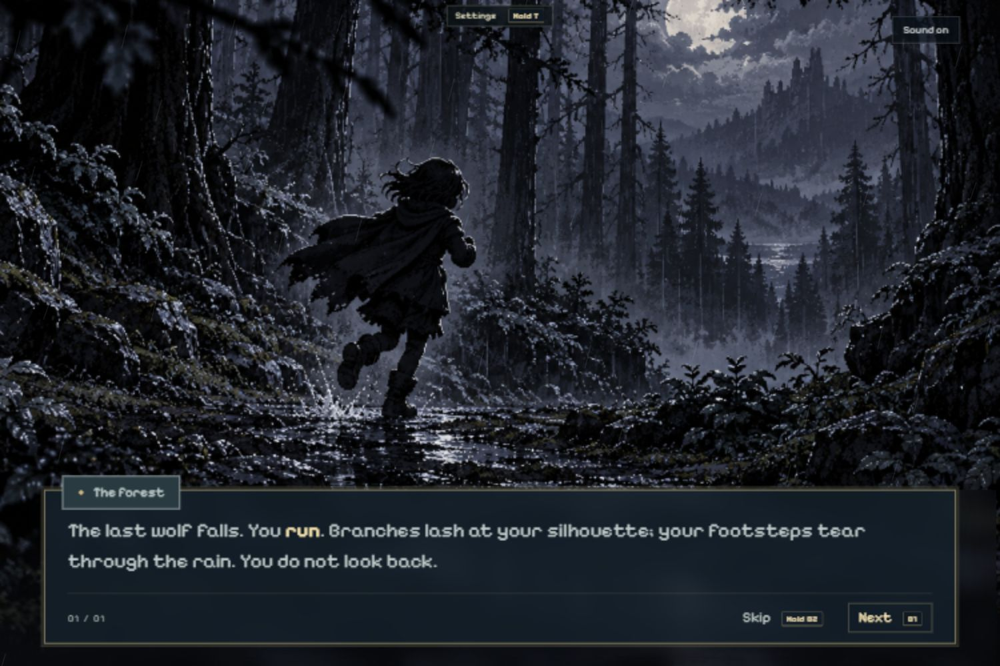</td>
  </tr>
  <tr>
    <td align="center"><sub><b>The wolf emerges.</b> Then the pack attacks.</sub></td>
    <td align="center"><sub><b>The escape.</b> A sprint through the rain toward the castle.</sub></td>
  </tr>
  <tr>
    <td width="50%">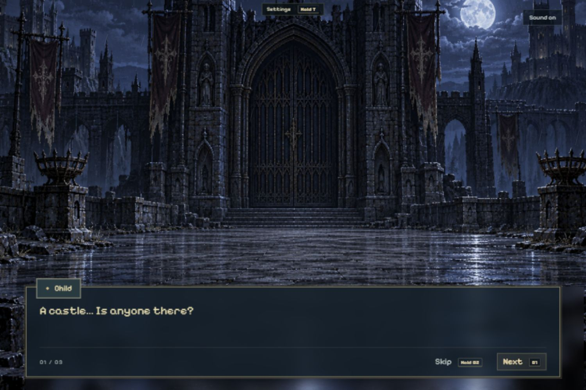</td>
    <td width="50%">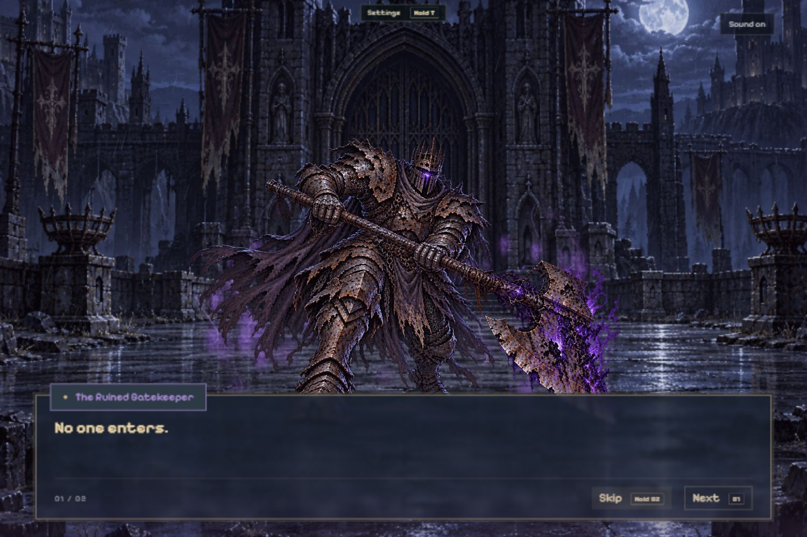</td>
  </tr>
  <tr>
    <td align="center"><sub><b>The castle gate.</b> Deserted, until it isn't.</sub></td>
    <td align="center"><sub><b>The Ruined Gatekeeper.</b> "No one enters."</sub></td>
  </tr>
</table>

The whole adventure runs from start to finish:

<p align="center">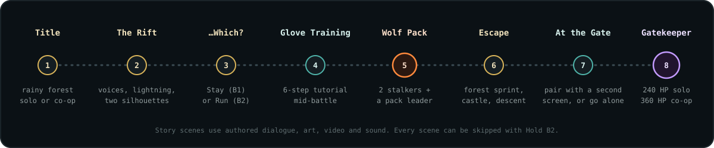</p>

Every scene uses hand-authored dialogue, pixel art, video clips and sound: there is no runtime generation. Each speaker has their own color and pitch, and rain keeps falling underneath. **Hold B2** skips dialogue but still stops at the Stay/Run choice, and **Hold T** opens the pause and settings menu at any time. A *Fast* pace option on the title screen multiplies your spell damage by 4, so each fight ends in a few casts for demos. Reduced-motion mode turns off camera shake and flashes.

---

## The enchanted glove

The controller is a glove we built from an **Arduino Uno R4 WiFi** and a **Grove Base Shield**. It has no game logic. It streams raw sensor readings over Wi-Fi about 40 times a second, and the browser turns them into presses, holds, dial turns and swings.

<p align="center">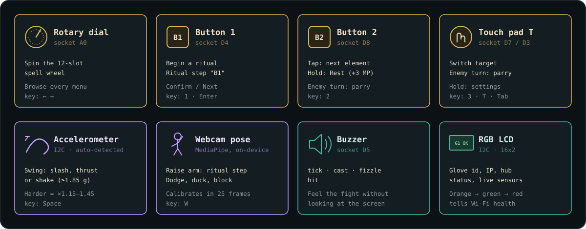</p>

- **Dial (A0).** Turns the 12-slot radial spell wheel and navigates every menu. The reading has hysteresis, so it doesn't flicker when it sits on a slot boundary.
- **B1, B2 and T (D4, D8 and D7/D3).** Open and weave spell rituals, change element, switch target, cycle duel cast speed, rest (`Hold B2`), parry (`T` or `B2`) and open the pause menu (`Hold T`).
- **Accelerometer (I2C).** A swing over 1.85 g counts as a gesture. The firmware auto-detects LIS3DHTR, ADXL345 and MMA7660 chips, and the game classifies each swing as a *slash*, *thrust* or *shake*. A harder swing gives a stronger cast, and shaking the glove raises a *Glove Ward* parry against incoming attacks.
- **Buzzer (D5).** Gives you instant haptic-style feedback, so you can feel the fight without looking at the screen:
  - `tick` when the dial lands on a new spell, when your turn starts, or when you trigger a parry
  - a rising `cast` chirp when a spell leaves your hand
  - a falling `fizzle` when a cast is refused or dodged
  - two low thuds (`hit`) when an enemy wounds you
- **LCD (I2C).** Shows the active spell, Magic Power, health and hub status. On the v2 screen, where the text is unreadable, the backlight color carries the status instead: orange while joining Wi-Fi, green when connected, red on a failure.

Although the on-screen UI shows only physical glove controls, every input also has a silent keyboard fallback so the game can be played or tested without hardware.

---

## Casting a spell

There are **12 spells**, four each in **Fire**, **Frost** and **Storm**. In the story adventure you start knowing one spell per element (`Ember Bolt`, `Frost Shard` and `Storm Spark`) and discover the others by following the hints on the wheel and weaving their rituals correctly.

<p align="center">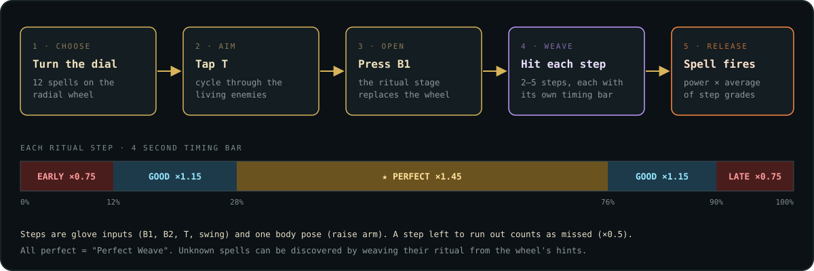</p>

<table>
  <tr>
    <td width="50%">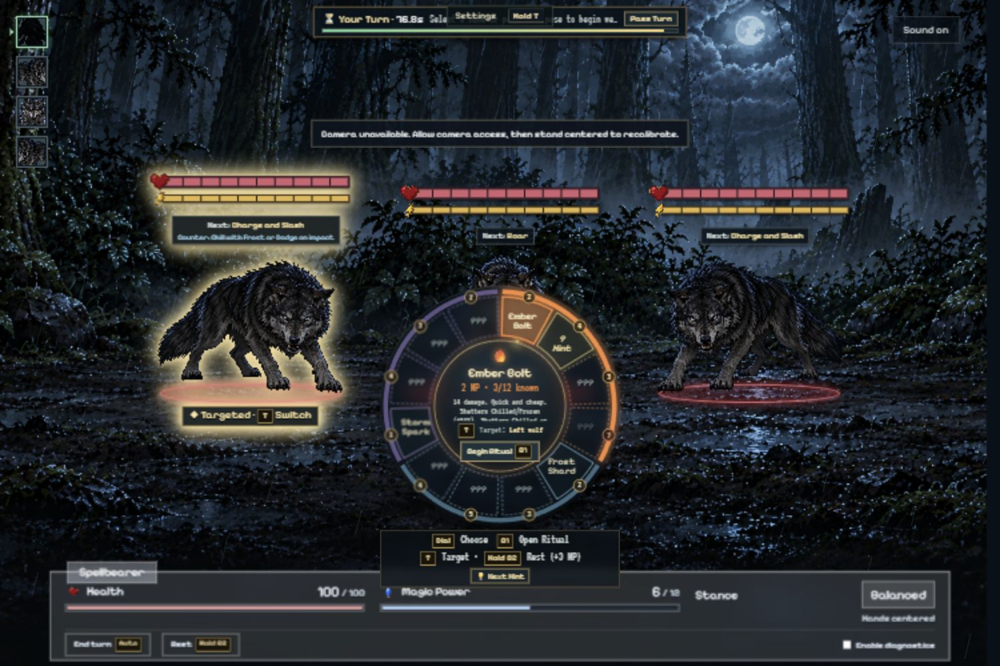</td>
    <td width="50%">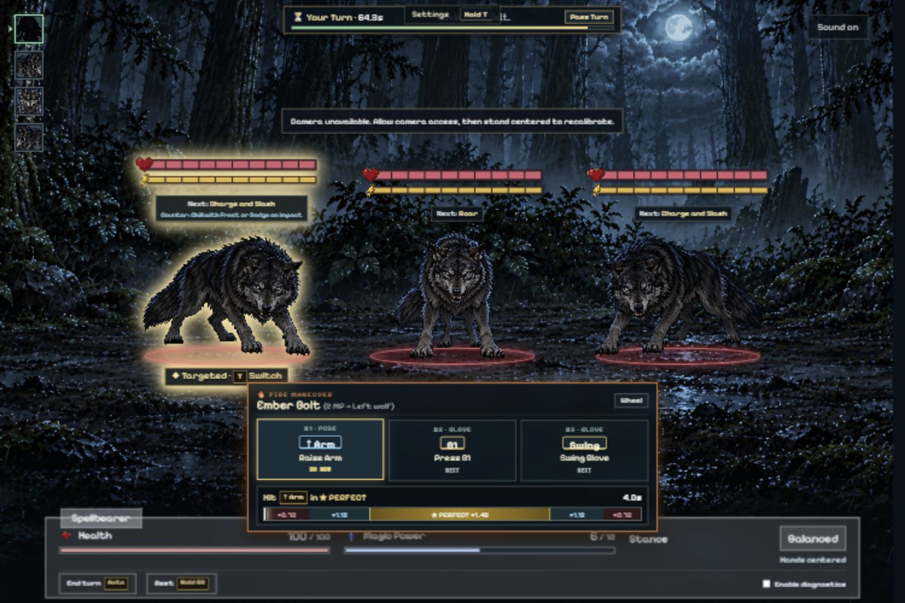</td>
  </tr>
  <tr>
    <td align="center"><sub><b>The spell wheel.</b> Dial to choose, T to target, B1 to begin.</sub></td>
    <td align="center"><sub><b>The ritual.</b> Ember Bolt: raise your arm, press B1, swing.</sub></td>
  </tr>
</table>

Each spell has its own **ritual**: a sequence of two to five glove inputs (`B1`, `B2`, `T`, `Swing`) and webcam body poses (`↑ Arm`), each with a live timing bar. Hitting a step in the gold zone is **★ Perfect** (×1.45). The grades of all the steps are averaged into the spell's final power. Raising your arm for a body pose naturally moves the glove, so stray accelerometer swings never break an active ritual.

| Element | Role | Spells |
| --- | --- | --- |
| 🔥 **Fire** | High damage & shatters Chilled/Frozen (+50%) | **Ember Bolt** (2 MP, 14 dmg) · **Fire Lance** (4 MP, 32 pierce dmg) · **Immolate** (3 MP, 8 dmg + 6/turn Burning) · **Meteor** (7 MP, 34 dmg + 16 splash) |
| ❄️ **Frost** | Shields you & slows or freezes enemies | **Frost Shard** (2 MP, 10 dmg + Chilled) · **Ice Shield** (3 MP, 18 shield) · **Frost Prison** (5 MP, Frozen 2 turns) · **Frost Nova** (4 MP, 12 area dmg + Chilled) |
| ⚡ **Storm** | Cheap, chains across packs & conducts (+4 dmg, +1 MP) | **Storm Spark** (1 MP, 7 dmg) · **Chain Lightning** (4 MP, 16 / 10 / 6 chain dmg) · **Static Shock** (3 MP, 8 dmg + strips Roused & Drains energy) · **Overcharge** (2 MP, next spell ×1.5) |

Every spell is charged in your hand first, with a pulsing aura, a turning sigil and element motes, before it flies. Fire Lance streaks through its target, Meteor falls from the sky, Frost Nova erupts in a ring of ice spikes, and Chain Lightning visibly jumps from enemy to enemy.

---

## Combat

<p align="center">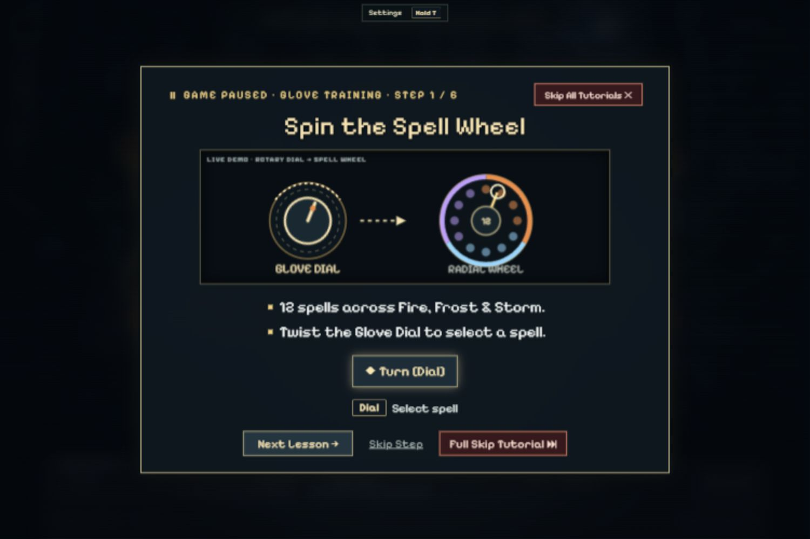</p>

The first fight pauses for an interactive **six-step Glove Training** tutorial: spin the wheel, change element, pick a target, weave a ritual, cast, and parry a mid-lunge wolf attack.

**Your turn.** Cast a spell or **Hold B2** to **Rest**, which restores 45 stance and 3 MP. Your HUD tracks:

- **Health** (100 max)
- **Magic Power** (12 max, regenerates 2 per turn)
- **Stance**: *Balanced*, *Shaken*, *Casting*, *Guarding* or *Staggered*. While Staggered you can't cast.

**Their turn.** Enemies telegraph their moves at 2.4×–3.6× playback speed. You defend in one of two ways:

- **With the glove.** Shake it or tap `T` / `B2` to raise a *Glove Ward* parry, halving damage and reflecting 6 damage back at the attacker.
- **With your body.** With the webcam enabled, the game projects a translucent outline of you, with shrinking impact rings over the parts of your body that are about to be hit. Dodge left or right, duck, or raise your right arm to block. Pose tracking runs locally on your machine with MediaPipe, and no camera pixels are shown or uploaded.

A correct dodge avoids the hit completely. A block cuts health damage to 25% and stops bleeding and curses.

### The wolf pack

Two **Stalkers** (40 HP) flank a **Pack Leader** (60 HP, armored). They **Roar** to become *Roused* (+25% damage, +2 armor), **Charge and Slash** to make you bleed, use **Jaw and Grab** to break your stance, and **Rest** to recover energy. Each move is a canvas-keyed video clip tied to the moment of impact.

### The Ruined Gatekeeper

<p align="center">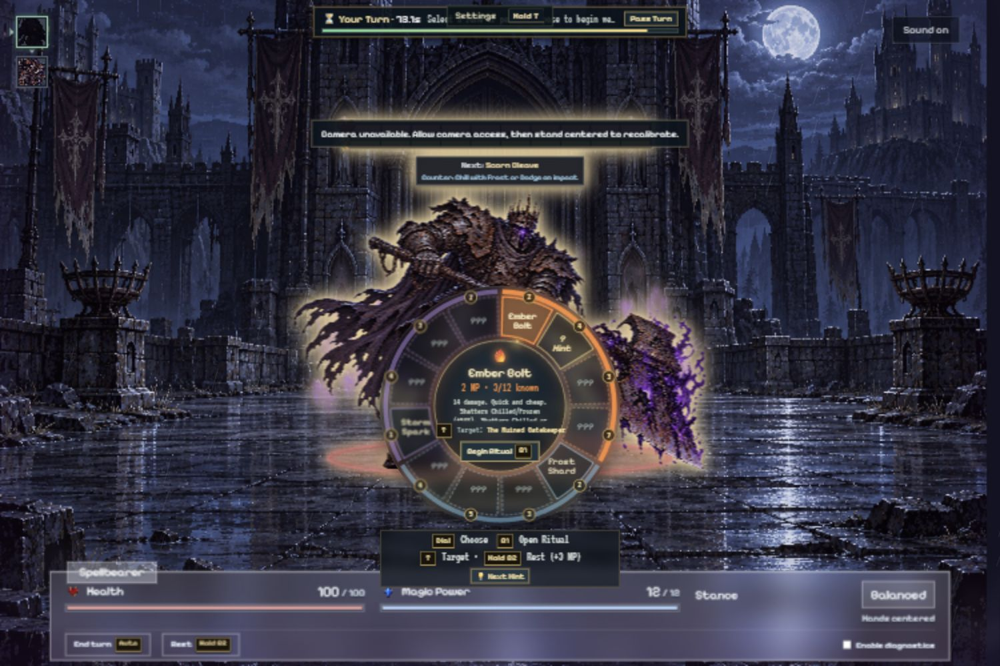</p>

The final boss has **240 HP** (360 HP in co-op), heavy armor (4 flat reduction) and a purple flame aura.

- **Scorn Cleave** curses you with *Scorn* (3 HP lost per turn).
- **Eclipse of Scorn** stops your passive Magic Power regeneration and deals 4 HP per turn.
- **Scorn Inferno**, his ultimate, sets the battlefield on fire for five turns (4 HP per turn).

His arrival shakes the camera with stone debris and shockwaves, and each of his axe hits leaves a jagged purple gash across the screen.

---

## Co-op on two screens

Two players, each with their own glove and laptop, can face the Gatekeeper together.

1. Each player plays the story and the wolf fight on their own screen (or jumps straight to the gate using the **Boss fight** button on the title screen).
2. At the castle gate, the game waits and announces itself on the glove hub. When a second screen does the same, the two pair up. *Fight alone* skips this.
3. The **host** runs the fight and sends numbered snapshots to the guest. The **guest** mirrors the fight and sends casts, rests, glove parries and webcam dodges/blocks back as intents, with optimistic local parry feedback and padded hold windows to absorb network/video skew.
4. Turns go host, then guest, then the Gatekeeper, who has **360 HP** in co-op. Scorn Cleave targets whoever has hurt him most since his last attack.
5. Each screen stays in first person: your spells leave your hand, and your partner's fly in from the right edge.

There is no extra server: the glove hub both laptops already use relays the co-op fight, and only streams each glove's 40 Hz sensor frames to the laptop that claimed it so Wi-Fi traffic stays lean.

---

## Duel mode (PvP & AI Speed Contest)

Pick **Duel (PvP)** on the title screen to enter the moonlit forest clearing and face a **Rival Spellbearer** in a real-time **Speed Spellcasting Contest**—either against another player on a second laptop via the glove hub, or solo against the **AI Speed Caster**.

- **Same 12 Spells & Left-Docked Wheel.** Duel mode uses the full 12-spell radial wheel (`Fire`, `Frost` and `Storm`) and timed ritual stage, docked to the left side of the screen so the Rival Spellbearer sprite in the center of the clearing stays in full view. All 12 spells are unlocked from the start, Magic Power regenerates rapidly (`1.4 MP/s` + `4 MP` on `Hold B2` Rest), and you can see which spell your rival is currently weaving above their health bar (`⚡ Weaving Fire Lance (2/4)`).
- **Selectable Spell Cast Speed (`1× Swift`, `1.5× Rapid`, `2× Blitz`).** Tap `T` on the wheel (or click the speed selector in the top bar) to choose your casting speed tier:

| Speed Tier | Ritual Slider | Enemy Osu! Ring Windup | Ring Stagger | Damage Multiplier |
| --- | --- | --- | --- | --- |
| **1× Swift** | 2.20 s / step | 1.45 s | 0.65 s | ×1.00 |
| **1.5× Rapid** | 1.45 s / step | 1.05 s | 0.48 s | ×1.15 |
| **2× Blitz** | 0.95 s / step | 0.76 s | 0.36 s | ×1.30 |

- **Disjoint (Staggered) Osu! Body-Part Rings.** When your rival finishes a spell, 2 to 3 Osu!-style shrinking target circles lock onto random locations on your projected body pose (`#1 HEAD`, `#2 L ARM`, `#3 R ARM`, `#4 CORE`) with **disjoint, staggered start and impact timers**. Each ring locks onto your body part at the exact moment its individual timer starts—so a single early movement won't clear all of them.
- **Dodge & Parry While Weaving.** You don't stop casting to defend: move the targeted body part out of each shrinking circle before it closes (or raise your right arm, shake the glove, or tap `T` to Parry the next closing ring for 70% damage reduction) while continuing to weave your own spell ritual with `B1`, `B2` and `Swing`.

---

## How it fits together

<p align="center">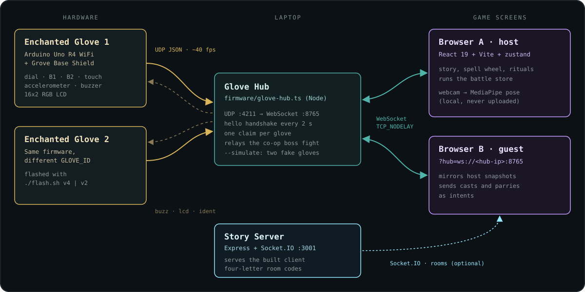</p>

| Piece | Tech | What it does |
| --- | --- | --- |
| **Firmware** (`firmware/enchanted_glove`) | Arduino C++ | Streams 40 Hz JSON sensor frames over UDP. Plays buzzer patterns without blocking. Shows status on the v4/v2 LCD. |
| **Glove hub** (`firmware/glove-hub.ts`) | Node, built-ins only | Bridges UDP :4211 to WebSocket :8765. Says hello to each glove, lets one player claim each glove, filters 40 Hz frame streams per owner, and relays co-op and duel messages with `TCP_NODELAY`. |
| **Client** (`client/`) | React 19 · Vite · zustand · motion · MediaPipe | Runs the story, spell wheel, rituals, combat stores, VFX, audio, webcam defense, PvP/AI duel arena, in-memory decoded image preloader and the debug labs. |
| **Server** (`server/`) | Express · Socket.IO | Serves the built client with immutable asset caching, four-letter room codes, and the round-based combat engine used by the labs. |
| **Shared** (`packages/shared`) | TypeScript | The contract types and constants the client and server both use. |

---

## Getting started

**Requirements:** Node 22 or newer and pnpm 10. The glove hardware is optional.

```bash
pnpm install
```

### Combined Launch Commands

Every launch command starts both the **Game Server** and the **Glove Hub** together in one terminal (and `Ctrl+C` stops all processes cleanly):

```bash
pnpm dev
```
Starts the Vite dev client (`:5173`), the story/combat server (`:3001`), and the glove hub (`:8765`).

```bash
pnpm demo
```
Builds the production client bundle and starts both the Node server (`:3001`) and the glove hub (`:8765`).

```bash
pnpm start
```
Starts both the Node server (`:3001`) and the glove hub (`:8765`) immediately using the existing build.

### With physical gloves

1. Copy `firmware/enchanted_glove/wifi_secrets.example.h` to `wifi_secrets.h` and fill in your hotspot's name and password.
2. Flash each glove with its own id (`./flash.sh v4` for Glove 1 on `D7` touch, and `./flash.sh v2 2` for Glove 2 on `D3` touch).
3. Put the host laptop on the same hotspot and run `pnpm demo` (or `pnpm dev`).
4. A second laptop joins the same game and hub by opening:
   ```text
   http://<host-laptop-ip>:3001/?hub=ws://<host-laptop-ip>:8765
   ```
   *(The hub prints this exact address when it starts. Click **Preload game** on the title screen to download and pre-decode all art, audio, video and MediaPipe WASM/model assets into memory ahead of play.)*

To try everything without hardware, run the hub with two simulated gloves:

```bash
pnpm --dir firmware hub:simulate
```

### Build and test

```bash
pnpm test
pnpm typecheck
```

---

## Repository layout

```
.
├── client/                 React game (Vite)
│   ├── public/art/         Pixel art, enemy move videos, particles
│   ├── public/audio/       Music, ambience and sound effects
│   └── src/
│       ├── combat/         Spells, rituals, battle store, status effects, boss AI
│       ├── duel/           Real-time PvP & AI speed duel in the wolf clearing
│       ├── glove/          Glove input tracking, combat and menu controls
│       ├── hardware/       Hub connection, glove simulator, wiring map
│       ├── vision/         MediaPipe pose service and pose classifiers
│       ├── net/            Co-op link, room store, in-memory asset prefetch
│       └── ui/             Story scenes, battle stages, HUD, VFX components
├── server/                 Express + Socket.IO, rooms and combat engine
├── packages/shared/        Shared types and constants
├── firmware/               Arduino sketch, flash script and glove hub
└── docs/                   Design notes and the combat reference
```

---

## Debug labs

Everything under `/debug` is a tool for developing and testing the game:

| Route | Lab |
| --- | --- |
| `/debug` | Command center |
| `/debug/hardware` | Live glove readings, a wiring map that shows which socket each part is plugged into, and a glove simulator |
| `/debug/vision` | Webcam pose tracking, Osu! target rings, and Survival Gauntlet classifier tests |
| `/debug/combined` | Glove and vision together |
| `/debug/audio` | Narrator voices and audio effects |
| `/debug/server` | Two simulated laptops playing against the real server |

In battle, the **Enable diagnostics** toggle lets you force spells to hit or miss, refill Magic Power, unlock all spells, reset an encounter, or instantly defeat every enemy.

---

<p align="center"><sub>Built in a weekend for HackTX 2026. Spell particles by <a href="https://kenney.nl">Kenney</a>. Pixel fonts: Pixelify Sans, Silkscreen and VT323 (OFL).</sub></p>
