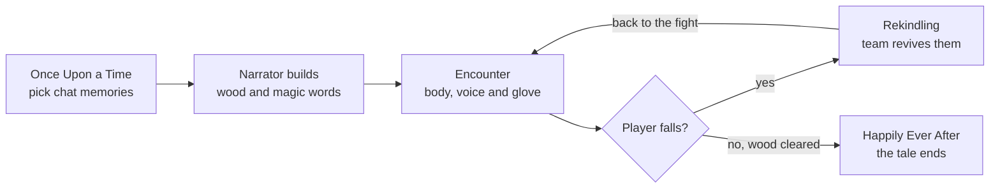

> Legacy design from the Meta track. The Muse parts (chat memories, world building, boss agent, voice incantations) were removed. The round loop, spells, Twin Cast, hearts and glove controls still apply.

# Aethren: HackTX Meta + Hardware Game Design

> Current art direction and Muse asset handoff: [Meta Muse asset-generation instructions](muse-asset-generation.md). Use this guide for the visual-novel presentation and generated artwork.

## Two glove wearers (P0 contract)

Both collaborators wear enchanted gloves: **a spellbearer on Laptop A** and **a spellbearer on Laptop B**. Each glove connects to its wearer's laptop through its own Arduino and serial bridge. Both players have the same dial, finger-button push-to-talk, fist charge, motion, touch-parry, and arm/disarm controls. Keyboard and on-screen inputs remain fallback controls for either player.

- Each laptop sends its own glove events. Relayed `hardware:event` payloads carry `playerId`; the server derives and validates ownership from the socket. A remote player's glove never changes local selection, recording, charge, or arming.
- Buzzer/servo commands go to the owning socket, or carry a target `playerId`. Both clients can execute their own commands. Untagged hardware-state broadcasts are ignored.
- Both players dodge, parry, and cast. Match elements and release within three seconds for Twin Cast, breaking the boss ward together. Team hearts and progress are shared.
- Disarming a glove stops only its wearer's inputs. Narration plays on the first player’s laptop to avoid duplicate audio; captions appear on both screens.
- Either player's color-token selection can request the shared boss memory; the server resolves requests into authoritative room state.

Last updated October 24, 2026. Design doc for our HackTX 2026 project (Meta track and Brick House).

## Pitch

Aethren is an online co-op fairy-tale battle game for 2 to 4 players, each at their own laptop, built from real moments in the group's Instagram chat. Each player wears an enchanted glove with a spell wheel on the forearm. Everyone speaks incantations into their mic and dodges with their whole body in front of their own webcam. The magic words come from the group's own stories, and the strongest spells only land when players in different places act at the same moment.

It's built for HackTX's fairy-tale theme ("Once upon a time, incredible things were built..."). It targets two tracks: Meta's "Bringing people closer together with AI" and Brick House (Best Hardware Hack). Under Meta's official rules, judges weigh human connection 30%, AI centrality 25%, originality 20% and execution and demo quality 25%.

The theme also fits A Bard's Tale (Best Pitch) and Jester's Court (Most Entertaining) if you want a third track.

## Core mechanics

Each mechanic ships in a simple P0 form for the demo and deepens in later tiers. P0 is the MVP: every component works once, end to end, before anything gets a second feature.

| Mechanic | P0 (demo) | Deepened in |
| --- | --- | --- |
| Memory-built world | Muse Spark finds moments in the group's Instagram chat and builds 1 encounter, a boss and 3 incantations | P1: a second encounter. P2: a full 3-encounter wood |
| Spell wheel | 3 elements on the dial: Ember, Frost, Bloom | P1: Storm. P2: Moon and Starlight |
| Incantations | Words only, checked against the phrase | P1: Command and Song tones |
| Full-body defense | Side-step out of your zone, then return to the silhouette; duck | P1: jump and shield. P2: freeze |
| Gesture delivery | Swipe and thrust | P2: channel and lunge |
| Collaborative spells | Twin Cast breaks the boss's ward | P1: Three-Part Spell, Mirror Strike, Rekindling. P2: Shield Wall, Count-in Quake, Linked Arch |
| Online play | 2 players on 2 laptops | P1: 3 players. P2: 4 players and a Fairy Godmother |
| Agentic AI | The boss plans its attacks with tool calls; Muse sets up the quest through our connector | P1: Muse shares the storybook. P2: the spellbook lives in Muse |

## Memories from your group chat

The memories come from a real Instagram group chat the players share, not from anything typed or spoken in the moment.

1. **Export.** One player requests their data from Instagram (Accounts Center, then Your information and permissions, then Export your information), choosing JSON and only messages. Small exports usually arrive quickly, but Meta allows up to 30 days, so request it right away.
2. **Upload and filter.** The host uploads the chat file to the server once. The server keeps only text messages from chat members and drops media, links and system messages.
3. **Find the moments.** One Muse Spark call reads the filtered chat and returns 3 to 5 memory cards as JSON. Each card has a short real quote, a date, the people involved, a mood and a color.
4. **Pick in the opening.** The cards appear on screen. Players choose which memories become the encounter and the boss, and real phrases from the chat become the incantations.
5. **Clean up.** The raw export is deleted after processing; only the selected cards are kept.

Instagram's messaging APIs can't do this: they only serve professional accounts, only cover one-on-one conversations with that account, and only return details for the 20 most recent messages.

## P0: the demo build

P0 is a 2-player run on 2 laptops that fits in about 4 minutes and uses every input, output and model at least once. Both laptops belong to spellbearers. Both wear their own enchanted glove and headset mic, collaborating on shared hearts and Twin Cast.

### The P0 run

**Setup (about 20 seconds).** A player asks Muse on their phone to set up the quest; Muse calls the game's tools and the room appears on both laptops (see Agentic AI).

1. **Opening (about 30 seconds).** Memory cards from the group chat appear on screen. One spellbearer turns the dial to browse them and clicks to keep one, and the other spellbearer uses their own dial and button to keep another. Holding a card's colored token under the token well makes that memory the boss. Muse Spark builds the encounter, the boss and 3 incantations while the Narrator reads the intro, and Muse Image paints 3 pictures.
2. **Encounter (about 60 seconds).** One monster, about 4 rounds. It uses a side sweep, a high swing and a projectile, so players side-step, duck and parry.
3. **Boss (about 90 seconds).** The boss raises a ward that only Twin Cast breaks. When it shatters, the servo opens the prop storybook. A few more rounds finish it.
4. **Ending (about 15 seconds).** Happily Ever After, read aloud, with the run's illustrations.

The team shares 5 hearts in P0, so there's no revive mechanic yet. If the team runs out of hearts, the tale ends early.

### Every component in P0

| Component | P0 use |
| --- | --- |
| Webcam (each laptop) | Zone dodge, duck, each spellbearer’s swipes and thrusts, and fallback arm-raise wheel control |
| Headset or close mic (each laptop) | Incantations, push-to-talk only |
| Rotary dial | Browses memory cards in the opening, then turns the Spellbearer's spell wheel through 3 elements |
| Finger button | Click to lock an element; hold to speak an incantation |
| Light sensor | Making a fist while speaking covers it and charges the spell for extra power |
| Accelerometer | Confirms the Spellbearer's swipe or thrust and adds power for speed |
| Touch pad | The Spellbearer parries projectiles |
| Switch | Arms and disarms the glove, camera and mic between turns and during the pitch |
| Sound sensor | Measures room noise; the game warns when it's too loud and raises the mic gate |
| Color sensor | Picks which memory card becomes the boss; that memory's mood sets its weakness |
| Buzzer | Wheel ticks, a successful cast, a fizzle and a hit |
| Servo | Opens the storybook when the ward breaks |
| Google Home Mini | The Narrator's voice on laptop A |
| Muse Spark | Finds memories in the group chat, builds the world and incantations, writes Narrator lines, and plays the boss as an agent with tool calls |
| Muse Voice Transcribe | Transcribes incantations |
| Muse Image | Paints the cover, the monster and the boss |
| MediaPipe Pose | Tracks each player's body on their own laptop |
| Muse agent and connector | Sets up the quest from a plain request on a player's phone |

## P1 to P3: what comes after the demo

Each later tier adds depth to mechanics P0 already proves. Nothing in P1 or later needs new hardware.

| Tier | Adds |
| --- | --- |
| P1 | Command and Song tones; jump and shield poses; Storm element; individual hearts with Rekindling; 3 players with the Three-Part Spell and Mirror Strike; a second encounter; Muse Spark names new spell combinations; Muse shares the run's storybook page to Instagram after a confirmation step |
| P2 | Moon and Starlight elements; the Stone Witch's freeze attack; channel and lunge; Shield Wall, Count-in Quake and Linked Arch; 4 players; Fairy Godmother mode; a full 3-encounter wood; a spellbook that lives in Muse, so players can later ask "What spells did we invent?" or "Set up a rematch Friday" |
| P3 | Leaning to vote at forks in the path; pose-matching doors between encounters; spectators who can watch a run |

## The storybook loop

Players open with memories from their group chat, the Narrator builds the wood and its magic words from them, and the team fights through it together. A fallen player comes back only if the others rekindle them.

Rekindling, highlighted, is the moment the team has to act as one to save someone. It arrives in P1; in P0 the team shares 5 hearts instead. A cleared wood ends the tale with Happily Ever After.

## Combat: how a round works

Each player stands in front of their own laptop, inside a marked zone in their own webcam view. Every screen shows the same battle: the enemy, the player's own camera with their silhouette, and teammates as glowing outlines drawn from their streamed body positions. Each encounter is a series of rounds until the enemy or the party falls.

1. **Telegraph (about 2 seconds):** the enemy winds up. A large arrow and a label show who it targets and how: a side sweep, a high swing or a projectile. The Narrator calls a hint.
2. **Defense window (about 1.5 seconds):** each targeted player dodges on their own camera. The Spellbearer can parry a projectile with a thumb press, sending it back.
3. **Return (about 3 seconds):** each player steps back into their silhouette. A player still outside their zone when the team turn starts can't cast that round.
4. **Team turn (about 8 seconds):** each player builds and casts one spell, or the team attempts a collaborative spell.
5. **Resolve (about 1.5 seconds):** damage lands, the buzzer and screens confirm what happened, and the next round starts.

A round takes about 16 seconds, so an encounter of 4 rounds fits in about a minute.

| Outcome | Effect |
| --- | --- |
| Clean dodge | No damage |
| Parried projectile | No damage, and the projectile hits the enemy |
| Missed dodge | The team loses 1 heart |
| Out of position at the team turn | That player sits out the turn |
| Failed incantation | The spell fizzles; the Narrator teases the caster |

P0 uses 5 shared team hearts. From P1, each player has 3 hearts, and a player at 0 hearts waits for a Rekindling.

## Spell wheel and spell creation

A spell is built from three choices: the element from the dial, the tone of the incantation, and the gesture that releases it. The code combines them by fixed rules, so every combination works without hand-designing each one.

**Both players (one glove each):**

1. Turn the forearm dial; the on-screen wheel rotates and the buzzer ticks at each slot. Click the finger button to lock the element.
2. Make a fist and hold the finger button with the thumb, then speak the element's incantation. The closed fist covers the palm light sensor and charges the spell.
3. Open the hand and swipe (aims left or right) or thrust (straight ahead) to release. The accelerometer confirms the motion and adds power for speed.

**Fallback controls for either player:**

1. Raise the right arm to turn the wheel one slot; hold still for 1 second to lock the element.
2. Hold the spacebar and speak the incantation.
3. Swipe or thrust toward the camera to release.

The code combines element, tone (from P1) and gesture by fixed rules, so every combination works without designing each one by hand.

| Element | Tier | Base effect |
| --- | --- | --- |
| Ember | P0 | Fire damage |
| Frost | P0 | Slows the enemy's next telegraph, giving a longer defense window |
| Bloom | P0 | Heals 1 heart |
| Storm | P1 | Damage that chains to a second enemy |
| Moon | P2 | Skips the enemy's next attack |
| Starlight | P2 | Only works as part of a collaborative spell |

| Tone | Tier | What it does to the spell |
| --- | --- | --- |
| Plain | P0 | The base effect; only the words are checked |
| Command (firm and loud) | P1 | Heavy: double damage, one target |
| Song (held, steady pitch) | P1 | Lasting: the effect repeats for 3 rounds |

Each encounter has an elemental weakness, set from the mood of the memory card it came from, so the team has a reason to switch elements. From P1, Muse Spark names each new element-and-tone combination the first time it's cast.

## Incantations

An incantation only works if the caster says the right words (and, from P1, uses the right tone). The words come from the group chat: when the world is generated, Muse Spark writes one short phrase per element from real phrases in it. If the chat keeps joking about a road trip where the car died, the Ember incantation might be "By the Corolla that would not start, burn!" Inside jokes become magic words.

### How an incantation is checked

**P0: words only.**

1. **Capture.** Push-to-talk opens the mic and closes it on release, so the game knows exactly where the incantation starts and ends, and room noise between casts is ignored.
2. **Words.** Muse Voice Transcribe turns the clip into text, and the game fuzzy-matches it against the expected phrase. A match of about 60% of the words passes, which forgives a noisy room.
3. **Mercy rule.** If a caster fails twice in a row, the third attempt succeeds at half power, so the demo never stalls on a bad mic moment.

**P1: words and tone.** The browser measures each clip's loudness, pitch, pitch steadiness, voicing and length. Muse Spark receives the transcript, those measurements and the required tone, and returns JSON with a pass or fail for words and tone, a power score from 0 to 1, and a line for the Narrator. Power scales the effect from half to one and a half times. If Muse takes longer than 1.5 seconds, the game uses local rules instead.

| Tone (P1) | What the game listens for |
| --- | --- |
| Command | High loudness, short and clipped, pitch falling at the end |
| Song | Voiced for most of the clip, steady pitch held over 1.5 seconds |

Tone checks lean on our own audio measurements because the public material on Muse Voice Transcribe doesn't describe tone or emotion detection. Each player uses their own headset mic, so a noisy room matters less than it would with one shared laptop mic.

## Full-body movement

Each laptop's webcam tracks one player's whole body, so dodging means actually moving. The screen shows the mirrored webcam view with a glowing outline of a person in the middle of the frame.

### The zone dodge and the return (P0)

1. At the start, the player stands inside the outline for 3 seconds, about 1.5 to 2 m from the laptop. The game records their standing height and shoulder width as a baseline.
2. The zone is only a little wider than the player's shoulders, so one side step of about half a meter clears it. When a side sweep targets them, they step out before the hit lands. If none of their torso is inside the zone at impact, they dodged.
3. Their outline then pulses and calls them back. It fills in as their body lines up with it, and snaps with a chime once they're back in place.
4. A player who isn't back by the team turn can't cast that round.

Teammates appear as outlines beside your own, so everyone can see who dodged and who is still out of position.

### Body actions

| Action | Tier | How the camera reads it | Use in the game |
| --- | --- | --- | --- |
| Side step | P0 | Shoulders and hips leave the zone's box | Dodge a side sweep or a projectile |
| Duck | P0 | Shoulders drop well below the standing baseline | Dodge a high swing |
| Raise the right arm | P0 | Right wrist above the head | Fallback spell-wheel control for either player |
| Swipe and thrust | P0 | Wrist speed and direction | Release a spell |
| Jump | P1 | Hips rise above the standing baseline | Dodge a ground wave |
| Shield | P1 | Forearms crossed in front of the face | Block a heavy blow at half damage |
| Freeze | P2 | Almost no movement for 2 seconds | Survive the Stone Witch's stare |
| Channel | P2 | Both wrists held above the head | Charge a spell; a longer hold adds power |
| Lunge | P2 | A step toward the camera, so shoulder width grows by 25% or more | A charging melee strike |
| Lean | P3 | Torso tilts left or right | The group votes at a fork in the path |
| Match the pose | P3 | Overlap with a target outline | Open an enchanted door by copying its pose |

## Collaborative spells

The most powerful spells need players on different laptops to act at the same moment, and every boss has a ward that only a collaborative spell can break. The server compares the timestamps of each player's action, so the windows are a little wider than they would be in one room, to allow for network delay. A shared meter on every screen fills as each player contributes, so everyone can see who still needs to act.

| Spell | Tier | Who does what | Sync window | Effect |
| --- | --- | --- | --- | --- |
| Twin Cast | P0 | Both players cast the same element, each with their own incantation and gesture | Both casts within 3 seconds | Breaks the boss's ward, then double damage |
| Three-Part Spell | P1 | The Spellbearer locks the element on the dial, a second player speaks the incantation, a third makes the release gesture | All three within 6 seconds | Triple damage |
| Mirror Strike | P1 | Everyone strikes the pose shown on screen on the Narrator's count | All within 1 second | Damage multiplied by the number of players |
| Rekindling | P1 | Standing players raise both arms and say the fallen player's name | All within 4 seconds | The fallen player returns with 1 heart |
| Shield Wall | P2 | Everyone takes the shield pose as the boss winds up its ultimate | All within 1.5 seconds | No damage to anyone; if anyone is late, everyone is hit |
| Count-in Quake | P2 | Everyone jumps on "three" | All within 0.75 seconds | Stuns the boss for a round |
| Linked Arch | P2 | Two players' outlines stand side by side on the shared stage; each raises the inner arm so the outlines' hands meet, while the Spellbearer thrusts | Hands meeting as the thrust lands | A piercing beam that ignores shields |

With players in different places, these spells need talk over voice chat or across the table: counting in, calling the element, and warning who is still out of position.

## Online multiplayer

A small hosted server runs the game, and each laptop is a client that tracks its own player. Each glove plugs into its own player’s laptop.

1. **Rooms.** Laptop A creates a room and shows a short code; other players open the game's link and enter it.
2. **One source of truth.** The server owns the round timer, the enemy, hearts and damage. Clients send what their player did; the server decides what happened and sends the result to every screen.
3. **Clock sync.** On joining, and every 10 seconds after, each client pings the server to estimate the difference between their clocks. Every action is stamped in server time, which is how collaborative spells are judged fairly.
4. **Scheduled telegraphs.** The server sends each attack with its impact time in server time, so every screen shows it at the same moment.
5. **Dodges are judged locally.** Each laptop checks its own player's position at the impact time, then reports the result, so network delay never costs anyone a dodge.
6. **What each laptop sends:** its player's body landmarks about 15 times a second, so teammates can be drawn as outlines (no video leaves the laptop); recognized actions and incantation results with timestamps; and its own glove’s events, identified by the player’s ID.
7. **Muse calls run on the server,** so the API key never reaches a laptop.
8. **Dropped players.** If a player disconnects, the game pauses for 10 seconds, then a simple bot takes their turns so the run can finish.

## Agentic AI

Two agents act on their own in P0: the boss, which plans its attacks against the players, and Muse, which sets up the quest from a plain request.

### The boss agent (Muse Spark with tool calling)

1. While a round plays, the server sends Muse Spark the state: each player's recent dodges and position, team hearts, elements used, the boss's hit points and the ward's status.
2. Muse Spark replies with tool calls that set up the next round. The server checks every call against the limits below.
3. If a call is invalid, or no reply arrives before the next telegraph, the boss falls back to a scripted pattern, so the game never waits.
4. The Narrator voices the boss's thinking in character ("The Rusted Steed has learned your habits, Dev"), so judges can see it adapt.

| Tool | What it does | Limits in code |
| --- | --- | --- |
| `choose_attack(pattern, targets)` | Picks the next attack and who it targets | Only patterns the enemy's template allows; targets must be players in the room |
| `adjust_timing(ms)` | Lengthens or shortens the defense window | 1.0 to 2.0 seconds |
| `raise_ward()` | Raises the ward that only Twin Cast breaks | Boss only, once per phase |
| `taunt(line)` | A Narrator line, spoken and captioned | 120 characters at most |
| `trigger_effect(name)` | A buzzer pattern or the servo | From a fixed list |

The prompt asks the boss to target a player who keeps dodging the same way, counter an element the team overuses, raise its ward below half health, and ease off when the team is down to 1 heart so the demo can finish.

### Muse as Quest Master (connector)

The game server offers an MCP endpoint over HTTPS, protected by a token. Muse builds its own connector to it once, writing the client itself; it runs in Meta's cloud, so it can reach the hosted server but not anything running only on a laptop.

1. A player asks Muse on their phone: "Set up a quest for me and Dev. Make it hard."
2. Muse chains the tool calls below, and the new room appears on both laptops.
3. During or after the run, players can ask Muse how the fight is going.

| Tool | Input | Returns |
| --- | --- | --- |
| `list_memory_cards` | None | Each card's ID, quote, mood and color |
| `create_quest` | Encounter card, difficulty (easy, normal or hard), player names | A room code |
| `invite_player` | Room code and player name | A join link |
| `get_quest_status` | Room code | Phase, team hearts and the boss's hit points |

The boss's memory is still picked in the opening with the color token, so the hardware stays part of setup. The tools only touch game data, never the raw chat export. If Muse access fails at the venue, an in-app quest box sends the same request to Muse Spark with the same tools.

### Later Muse features

| Tier | Feature | How it works |
| --- | --- | --- |
| P1 | Muse shares the storybook | After a run, a player asks Muse to post the storybook page (the run's illustrations and Narrator lines) to Instagram. Muse fetches it with a new `get_storybook` tool and posts through its built-in Instagram connector after the player confirms. Check that the connector can post before relying on it |
| P2 | The spellbook lives in Muse | New tools (`get_spellbook`, `schedule_rematch`) let players ask Muse days later "What spells did we invent?" or "Set up a rematch Friday with Dev" |

## Hardware: the enchanted glove

Each player’s glove and forearm band are wired to their own **Arduino Uno R4 WiFi** (`arduino:renesas_uno:unor4wifi`) topped with a **Grove Base Shield V2** (set to 5V) that talks to that player’s laptop over USB-C serial. P0 requires two glove/Arduino/shield assemblies, one per player. The Grove Base Shield covers the board's built-in LED matrix, but gives plug-and-play 4-pin Grove sockets for every sensor (`A0–A2`, `D2–D6`, and 4 parallel `I2C` sockets on `Wire` so both the accelerometer and the I2C color sensor plug straight in without breadboarding). Every laptop needs a webcam and a headset or close mic. All of the parts below are used in P0. The build uses 11 of the 14 listed parts and leaves out the UV, air quality and infrared sensors.

| Part | Where it sits | Role in the game |
| --- | --- | --- |
| Webcam | Each laptop, facing its player at 1.5 to 2 m | Tracks that player's body for dodges, wheel control and gestures |
| Headset or close mic | Each player | Push-to-talk incantations; a close mic keeps room noise out |
| Rotary angle sensor | Forearm band | Turns the spell wheel |
| Button | Side of the index finger | Click to lock an element; hold with the thumb to speak |
| Light sensor | Palm | Covered by a closed fist while speaking, which charges the spell |
| Accelerometer | Back of the hand | Confirms swipes and thrusts and adds power for speed |
| Touch sensor | Palm, under the thumb | Parry a projectile, sending it back |
| Switch | Forearm band | Arms and disarms the glove, camera and mic |
| Sound sensor | Table by laptop A | Measures room noise to set the mic gate and show a "too loud" warning |
| I2C color sensor | Table (the token well) | Hold a memory card's colored token under it to make that memory the boss |
| Buzzer | Forearm band | Wheel ticks, a successful cast, a fizzle and a hit |
| Servo | Table by laptop A | Opens a prop storybook when the boss's ward breaks |
| Google Home Mini | Table by laptop A | Speaks the Narrator's voice as a Bluetooth speaker (set it up on Wi-Fi first), or use laptop speakers if pairing fails |

Keep the glove wiring light, with long jumper wires from the Arduino on the forearm band. Test body tracking on each laptop in the actual demo spot early, and check the dial and push-to-talk button while the glove is worn.

| Part we skip | Why |
| --- | --- |
| UV sensor | Nothing in the game depends on sunlight or UV, so it would only be a gimmick |
| Air quality sensor | Slow to warm up and noisy, so it can't give the instant response a combat input needs |
| Infrared sensor | The light sensor and the camera already detect a closed fist, and its exact type is unclear, so keep it only as a backup |

## Camera tracking: how recognition works

Each laptop tracks only its own player, which keeps tracking fast and simple. At 1.5 to 2 m, whole-body landmarks are reliable, while individual finger shapes are not, so every camera action uses arms, torso or legs.

1. The webcam streams the mirrored view at about 30 frames per second.
2. MediaPipe Pose Landmarker finds 33 landmarks on the one person in the frame.
3. Zone checks measure how much of the player's shoulders and hips sit inside the zone, and how well their body overlaps the silhouette.
4. Pose rules compare landmarks with the player's baseline from calibration: shoulders down for a duck, right wrist above the head for a wheel turn, and so on.
5. Swipes and thrusts come from wrist speed and direction over the last few frames. Each player’s glove accelerometer confirms their gestures.
6. Each recognized action is stamped in server time and sent to the server, along with the landmarks for teammates' outlines.

### Risks and fallbacks

- **Space.** Each player needs about 2 m of width and 2 m of depth. Find the demo spot early.
- **Bystanders.** People walking behind a player can be picked up. Set the tracker to one person, ignore anyone much smaller in the frame, and face the camera toward a wall.
- **Lighting.** Use steady light on the player's front, not a bright window behind them.
- **Misfires.** Ignore actions outside their phase (dodges only in the defense window, casts only in the team turn) and require a minimum confidence.

## AI roles

AI builds and runs the whole game world, so removing it removes the game.

- **Muse Voice Transcribe:** transcribes every incantation.
- **Narrator & Boss Voice (TTS):** tries Meta Muse Voice / audio synthesis first on the Meta API key; if unavailable, falls back to ElevenLabs (`eleven_flash_v2_5`) or OpenAI TTS, with browser `window.speechSynthesis` as an instant offline fallback.
- **Muse Spark:** acts as the fairy-tale Narrator. It finds memorable moments in the group chat and turns them into the encounters, the boss and the incantation phrases, and writes Narrator lines. It also plays the boss as an agent, choosing each attack through tool calls. From P1, it also judges tone and names new spell combinations.
- **Muse Image:** paints the cover, the monster and the boss.
- **MediaPipe Pose Landmarker (computer vision):** tracks each player's body on their own laptop. No video is saved or sent.
- **Browser audio analysis (P1):** measures loudness, pitch and voicing for tone checks.
- **Muse agent:** sets up the quest through the game's MCP connector, from a plain request on a player's phone.

## World generation with Muse

Muse Spark writes the content and the game's code owns the rules, so a generated world can't break the game. Muse Spark supports structured output: it returns JSON that follows a schema we provide.

### What gets generated, and when

| When | Call | Output |
| --- | --- | --- |
| When the host uploads the chat (before the demo) | One Muse Spark call on the filtered chat | 3 to 5 memory cards: a real quote, date, people, mood and color |
| Right after the opening | One Muse Spark call with the chosen cards and player names | The world as JSON: title, intro narration, 3 incantation phrases, 1 encounter and a boss in P0 |
| Right after that, in parallel | 3 Muse Image calls in P0 | A cover, the monster and the boss |
| On every incantation | Muse Voice Transcribe | The transcript, matched against the phrase |
| During combat, not blocking play | Short Muse Spark calls | Narrator reactions to what players do |
| From P1, on incantations | Muse Spark | A tone verdict, power score and Narrator line; names for new combinations |
| Every round, in the background | Muse Spark with tool calling | The boss's next attack, timing, taunts and effects |

### The world schema

Each encounter names the memory it came from and picks one of four fixed templates. The templates set how an enemy fights, so Spark only chooses flavor and difficulty.

| Field | Type | Notes |
| --- | --- | --- |
| `title` | string | Name of the wood |
| `intro` | string | Opening narration, read aloud |
| `incantations` | one phrase each for `ember`, `frost`, `storm`, `bloom`, `moon`, `starlight` | Short and speakable, drawn from the memories |
| `encounters[].memory` | string | Which shared memory inspired it |
| `encounters[].name` | string | For example, "Rusted Iron Steed" from a road-trip breakdown |
| `encounters[].template` | `charger` \| `caster` \| `swarm` \| `guardian` | Sets hit points, timing and behavior in code |
| `encounters[].attacks` | list from `high_swing`, `low_sweep`, `ground_wave`, `projectile`, `stare` | Each maps to a body dodge in code |
| `encounters[].weakness` | one element | Set from the memory card's mood |
| `encounters[].tier` | 1 to 3 | Maps to hit points and attack speed in code |
| `encounters[].lines` | `string[]` | Taunts and telegraph hints in storybook voice |
| `encounters[].art_prompt` | string | Sent to Muse Image |
| `boss` | same shape as an encounter, plus `ward` | Always `tier` 3; `ward` names which collaborative spell breaks it |

### Guardrails

- **Clamp and default.** After parsing, force every number into its allowed range and replace any missing or unknown field with a default.
- **Hide the wait.** Start generation the moment the opening picks are made, while the Narrator reads the intro, and show placeholder art until each image arrives.
- **Prewritten fallbacks.** Keep a set of generic Narrator lines so combat never waits on a live call.
- **A cached demo world.** Save one complete generated world, with its images, as a file. The demo video runs from it if the venue wifi or rate limits fail. Rate limits for the API aren't published yet.
- **Budget.** Muse Image costs $0.01 per image, so a full run of about 10 images costs about $0.10 of the $50 in credits.

## Optional twist: the Fairy Godmother

In P2, one player joins as the Fairy Godmother. Online play makes this simple: only her screen shows the telegraphs, and the fighters' screens show the enemy winding up without saying which way it will strike. She calls out "Maya, duck! Dev, step left!" over voice chat. It forces constant communication and gives a fourth player an important role without a camera or glove.

## Build order

Build all of P0 before starting anything in P1; the tiers are laid out under Core mechanics, P0 and P1 to P3. See `docs/team-plan.md` for the full tech stack and 3-teammate parallel agent streams.

1. **Vertical slices:** the server creates rooms and syncs clocks, and two laptops show the same telegraph at the same moment; the Arduino Uno R4 WiFi streams the dial, button, accelerometer, touch and light readings; pose tracking and the zone work on one laptop; one Muse Voice Transcribe call, one Muse Spark JSON call and one Muse Spark tool call succeed; Muse connects to a test MCP endpoint.
2. **One full combat round:** one full round plays on two laptops: telegraph, side step, duck, return to the silhouette, spell wheel by dial and by arm raise, incantation word check, swipe or thrust release, and a parry.
3. **World generation & agents:** world generation from memories; the boss agent, its ward and Twin Cast; quest setup through Muse; the color token, the noise gate, the buzzer, the servo, Google Home narration and on-screen captions.
4. **Art, cache & fallback:** Muse Image art, the cached demo world and the bot fallback; a full run under 4 minutes.
5. **Rehearsal & demo video:** rehearse the live run twice and record the video. Start P1 only if P0 is solid.
6. **Submission:** finalize repo README and submit on Devpost.

## Live demo: noise, space, network and the 5-minute limit

The live demo has to survive a loud room, a cramped table, shaky wifi and a 5-minute slot.

### The 5 minutes

| Time | What happens |
| --- | --- |
| 0:00 to 0:30 | One-line pitch while players calibrate in their silhouettes |
| 0:30 to 4:30 | The P0 run: opening, encounter, boss and ending |
| 4:30 to 5:00 | How the AI works, then questions |

If time is short, a quick-start button skips card selection and uses saved picks, which saves about 30 seconds.

### Noise

- Each player wears wired earbuds or a headset with a mic close to the mouth. Bluetooth headsets add audio delay.
- Push-to-talk only: the mic never listens between casts.
- Incantations are 3 to 5 words with distinct sounds. A 60% word match passes, and the mercy rule guarantees a cast on the third try.
- The sound sensor reads room noise, raises the mic gate and shows a "too loud" warning.
- Everything the Narrator says also appears as a caption, since judges may not hear the speaker.

### Space and visibility

- Each player needs a 2 m by 2 m spot facing their laptop, ideally with the camera pointed at a wall so passersby stay out of frame.
- Put both laptops where judges can see them. Every screen shows the whole battle, so either one tells the story.
- Telegraphs, team hearts and the ward meter are drawn large enough to read from a few steps away.
- Each glove’s switch disarms its wearer’s glove, camera, and microphone while the team talks to judges.

### Network

- Host the server in the cloud. Venue wifi often blocks laptops from connecting to each other directly.
- Keep a phone hotspot as a backup connection.
- The cached demo world, with its images, loads instantly if Muse calls are slow.
- If laptop B drops, the bot takes over its turns after 10 seconds.
- Keep the recorded demo video ready as a last resort.

## Demo video script (2 to 3 minutes)

The script follows Meta's suggested breakdown. Build only what it shows.

| Time | What's on screen | Covers |
| --- | --- | --- |
| 0:00 to 0:25 | A player asks Muse to set up a quest, and two friends on two laptops load their Instagram group chat; real moments appear as memory cards, and their inside jokes become incantation phrases | The problem and human connection |
| 0:25 to 1:05 | Both players calibrate in their silhouettes. A side sweep hits; one player steps out and snaps back into the outline while the other ducks a high swing; a spellbearer parries a projectile | Full-body play and the glove |
| 1:05 to 1:40 | One spellbearer turns the dial to Ember, makes a fist, speaks the incantation and thrusts; the second spellbearer turns their glove dial to pick Frost and swipes | Spell wheel, incantations and gestures |
| 1:40 to 2:10 | The boss agent targets the player who keeps dodging left, then raises its ward. The players count in over voice chat and Twin Cast; the ward shatters and the storybook opens | Collaborative spells |
| 2:10 to 2:35 | Diagram of the pipeline: two laptops, the server, the glove, and Voice Transcribe, Spark and Image | How AI is integrated |
| 2:35 to 3:00 | Tools, models and coding assistants used during the build | Required tools section |

## Submission checklist

- [ ] Demo video, 2 to 3 minutes, uploaded
- [ ] Public GitHub repository, with libraries and our own code clearly identified in the README
- [ ] API keys kept out of the repo
- [ ] Submitted to the Meta-Sponsored Track by 11:30 AM CST Sunday, October 25
- [ ] Brick House (Best Hardware Hack) and any other prize tracks selected on Devpost
- [ ] Written consent from every member of the group chat used, and from everyone whose voice appears in the demo

## Open questions

- How many people are on the team? P0 needs 2 players for the demo.
- Has someone requested the Instagram export (JSON, messages only) from a chat where every member consents?
- Rohan's additional attack patterns: not yet added to the doc.
- Do we have two wired headsets or earbuds with mics?
- Where will the server be hosted, and has the venue wifi been tested with two laptops?
- Have the $50 Muse API credits been redeemed and tested?
- Which stack do we approve? It goes in a Stack and repo section once agreed.
- Can someone on the team use Muse with their account, and can Muse build a connector to a test MCP endpoint?
- Can Muse's built-in Instagram connector read a group chat? If it can, Muse could pull memories directly instead of the export.

## Caveats

Four constraints shape the build.

- **Originality:** keep all names, art and incantations original, and write all code during the hacking period. MediaPipe is a permitted library, but identify your own contribution clearly in the repo.
- **Consent:** Meta's rules prohibit collecting personal information without express written consent. Use only a group chat whose members have all agreed in writing, ideally your own team's. Show only the selected quotes, delete the raw export after processing, and send only body landmarks between laptops, never video.
- **Two Arduinos:** each player’s glove connects to its own laptop; hardware events and feedback are routed by player identity.
- **Space and network:** body tracking needs room and light, and online play needs a connection the venue doesn't block. Test both in the real demo spot in the first hours.

## Sources

- [HackTX 2026 on Devpost](https://hacktx26.devpost.com/)
- Meta-Sponsored Track Round 1 Official Rules (HackTX 2026)
- [Meta Model API guide (Layer3 Labs)](https://www.layer3labs.io/guides/meta-model-api-guide)
- [Meta ships Muse Image API at $0.01 per image (RuntimeWire)](https://runtimewire.com/article/meta-ships-muse-image-api-at-one-cent-per-image)
- MLH Hardware

## All players are spellbearers

There is no laptop role selection. Create, join, and quick-start automatically use the `spellbearer` class for every player, with identical glove controls. Players are distinguished by unique `playerId`, never by class. The server emits `room:joined { playerId }` to the joining socket before room snapshots; names are only a fallback when uniquely matched. Hardware messages remain scoped to player IDs. The first player in room order handles narration to avoid duplicate audio, independently of class. Shared hearts, encounters, and Twin Cast remain collaborative.
